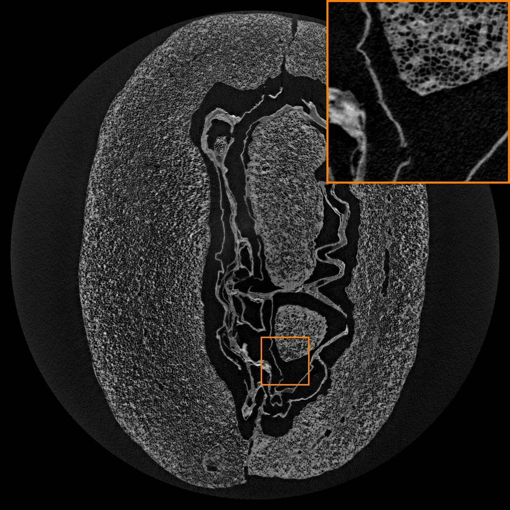
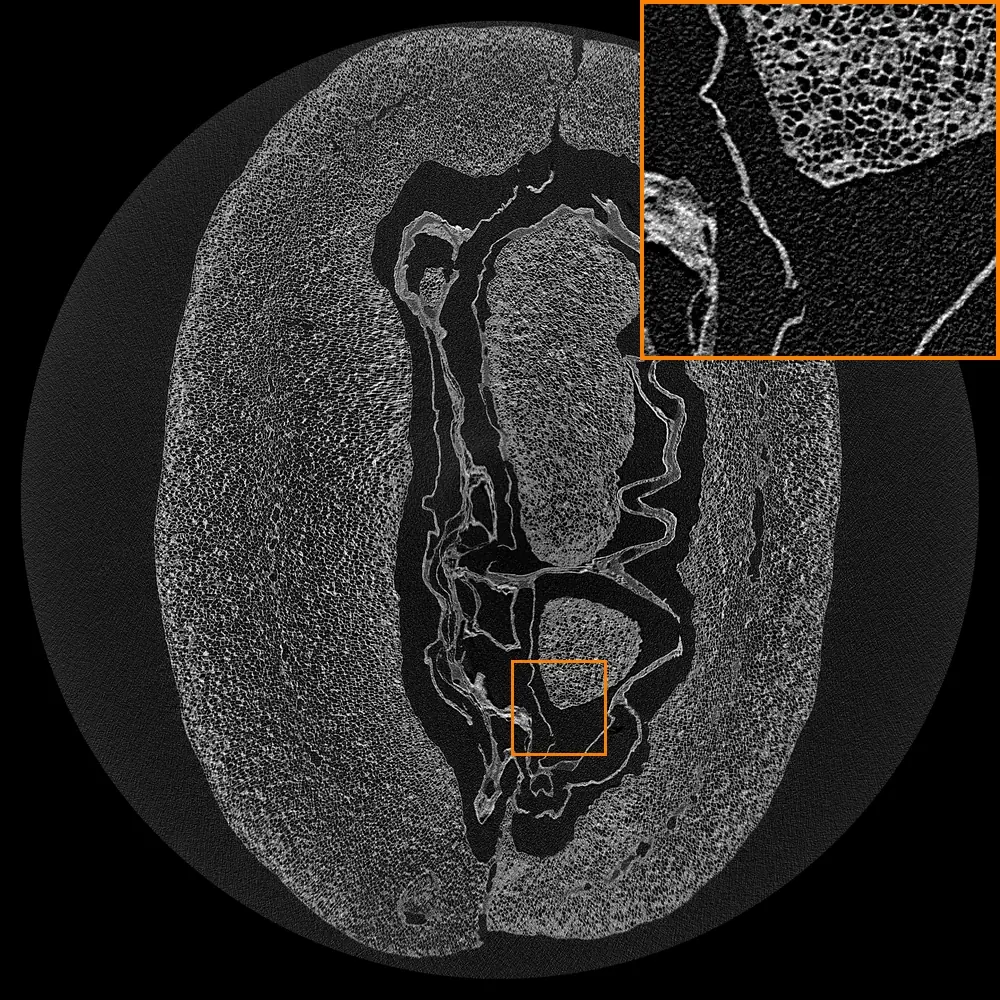

# TIGRE

<div class="tigre-band">
<div class="tigre-band-inner">
<div class="tigre-band-text">

```{image} _static/logo/tigre-logo-dark.svg
:alt: TIGRE
:class: tigre-hero-logo
```

<p class="tigre-tagline">Fast, flexible 3D CT reconstruction on GPUs, for MATLAB and Python.</p>

TIGRE, the Tomographic Iterative GPU-based Reconstruction toolbox,
reconstructs images from any scanning geometry with multi-GPU projectors
and a wide range of iterative algorithms.

<div class="tigre-actions">

```{button-ref} install/index
:ref-type: doc
:color: primary

Install TIGRE
```

```{button-ref} demos/index
:ref-type: doc
:color: secondary
:outline:

See the demos
```

```{button-link} https://github.com/CERN/TIGRE
:color: secondary
:outline:

View on GitHub
```

</div>

<p class="tigre-news">

**New in {{ latest_version }}** ({{ latest_date }}): faster projectors and
backprojectors on one and several GPUs. Read the
[release notes](changelog.md) or {{ latest_download }}.

</p>

</div>

<figure class="tigre-compare">
<div class="tigre-compare-frame" style="--pos: 50%">


<span class="tigre-compare-name tigre-compare-left" aria-hidden="true">FDK</span>
<span class="tigre-compare-name tigre-compare-right" aria-hidden="true">CGLS</span>
<input class="tigre-compare-range" type="range" min="0" max="100" value="50" step="1" aria-label="Move the divider between the FDK reconstruction (left) and the CGLS reconstruction (right)">
<span class="tigre-compare-handle" aria-hidden="true"></span>
</div>
<figcaption>A coffee bean, 3340 × 3340 × 900 voxels from 2134 projections. Drag the divider to compare FDK with CGLS.</figcaption>
</figure>

</div>
</div>

## A reconstruction in a few lines

::::{tab-set}
:sync-group: lang

:::{tab-item} Python
:sync: python

```python
import numpy as np
import tigre
import tigre.algorithms as algs
from tigre.utilities import sample_loader

geo = tigre.geometry_default(high_resolution=False)   # a cone-beam scanner
angles = np.linspace(0, 2 * np.pi, 100)
head = sample_loader.load_head_phantom(geo.nVoxel)

proj = tigre.Ax(head, geo, angles)                     # simulate the scan
img_fdk = algs.fdk(proj, geo, angles)                  # filtered backprojection
img_ossart = algs.ossart(proj, geo, angles, 20)        # 20 iterations of OS-SART
```
:::

:::{tab-item} MATLAB
:sync: matlab

```matlab
geo = defaultGeometry('nVoxel', [128; 128; 128]);     % a cone-beam scanner
angles = linspace(0, 2*pi, 100);
head = headPhantom(geo.nVoxel);

proj = Ax(head, geo, angles);                         % simulate the scan
imgFDK = FDK(proj, geo, angles);                      % filtered backprojection
imgOSSART = OS_SART(proj, geo, angles, 20);           % 20 iterations of OS-SART
```
:::
::::

Swap the phantom for your own projections, or use one of the
[scanner loaders](user-guide/loading-data.md), and change the geometry to
match your system. The [demos](demos/index.rst) go through every step.

## Why TIGRE

::::{grid} 1 2 2 3
:gutter: 4
:class-container: tigre-why

:::{grid-item}
**[Any geometry](user-guide/geometry.md)**

Cone beam, parallel beam, helical, tomosynthesis, C-arm and curved
detectors. Geometric parameters are defined per projection, not per scan.
:::

:::{grid-item}
**[State-of-the-art speed](technical-notes/speed-3.3.1/index.md)**

Optimised CUDA projectors and backprojectors, among the fastest available,
that split problems larger than GPU memory across one or several GPUs.
:::

:::{grid-item}
**[Many algorithms](user-guide/algorithms.md)**

FDK/FBP, the SART family, Krylov methods (CGLS, LSQR, LSMR, GMRES, hybrid),
MLEM, total-variation and prior-image methods, and more.
:::

:::{grid-item}
**[MATLAB and Python](user-guide/interoperability.md)**

The same toolbox and the same demos in both languages, and PyTorch
operators with gradients for learned reconstruction.
:::

:::{grid-item}
**[Real data](user-guide/loading-data.md)**

Loaders for Nikon, Bruker, YXLON, Diondo and Varian scanners, DXchange
synchrotron data and DICOM (MATLAB).
:::

:::{grid-item}
**[Widely used](papers.md)**

Used in {{ papers_count }} published papers, in medicine, synchrotron and
industrial imaging, particle therapy and reconstruction research.
:::
::::

## From real scans

::::{grid} 2 2 4 4
:gutter: 2
:class-container: tigre-strip

:::{grid-item-card}
:link: gallery/index
:link-type: doc
```{image} gallery/images/v3-varian-head.jpg
:alt: Head scanned on a clinical Varian cone-beam CT
```

Clinical cone-beam CT
:::

:::{grid-item-card}
:link: gallery/index
:link-type: doc
```{image} gallery/images/v3-synchrotron.jpg
:alt: Synchrotron scan reconstructed with several algorithms
```

Synchrotron
:::

:::{grid-item-card}
:link: gallery/index
:link-type: doc
```{image} gallery/images/v3-battery.jpg
:alt: Helical micro-CT scan of a battery
```

Helical micro-CT
:::

:::{grid-item-card}
:link: gallery/index
:link-type: doc
```{image} gallery/images/v3-neutron-padlock.jpg
:alt: Neutron tomography of a padlock
```

Neutron tomography
:::
::::

[More in the Gallery](gallery/index.md)

## Get started

::::{grid} 1 1 3 3
:gutter: 3
:class-container: tigre-start

:::{grid-item-card} Install
:link: install/index
:link-type: doc
Prebuilt wheels for Python on Linux, or build TIGRE for MATLAB and Python
from source.
:::

:::{grid-item-card} Learn
:link: user-guide/index
:link-type: doc
The user guide: geometry, algorithms, real data, and what to check when a
reconstruction looks wrong.
:::

:::{grid-item-card} Reference
:link: api/index
:link-type: doc
Every function and option, in Python and MATLAB.
:::
::::

## Who makes TIGRE

TIGRE is open source under the
[BSD 3-clause licence](https://github.com/CERN/TIGRE/blob/master/LICENSE.txt).
The copyright and the licence are held by the University of Bath and CERN,
where TIGRE was first developed. Ander Biguri has led its development since,
at the University of Southampton and now at the University of Cambridge, with
[contributions from many people](https://github.com/CERN/TIGRE#contributors-).
The Universities of Southampton and Cambridge do not hold the copyright or
the licence.

TIGRE has been funded by CERN, the EPSRC, the European Metrology Research
Programme and the Accelerate Programme for Scientific Discovery; see the
[acknowledgements](acknowledgements.md).

```{toctree}
:hidden:
:maxdepth: 2

install/index
user-guide/index
demos/index
gallery/index
api/index
citing
papers
technical-notes/index
ecosystem
roadmap
help
contributing
changelog
acknowledgements
```
